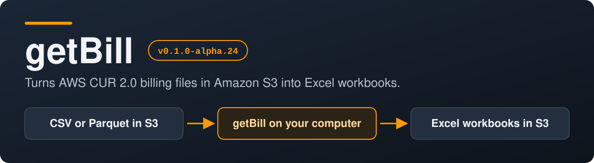

# getBill v0.1.0-alpha.13

_Last modified: 2026-11-17 13:10 EST_

<p align="center">
  
</p>

<p align="center">
  
  
  
  
  
  <a href="https://scriptbuzz.github.io/getbill/"></a>
  <a href="https://github.com/scriptbuzz/getbill/actions/workflows/tests.yml"></a>
  
</p>

<p align="center">
  <a href="https://scriptbuzz.github.io/getbill/getbill-run-recording.html"><b>Watch the walkthrough</b></a>
  &nbsp;·&nbsp; <a href="#install">Install</a>
  &nbsp;·&nbsp; <a href="#run-it-interactively">Run it</a>
  &nbsp;·&nbsp; <a href="#permissions-each-profile-needs">IAM permissions</a>
  &nbsp;·&nbsp; <a href="docs/getbill-flow-diagram.svg">Flow diagram</a>
  &nbsp;·&nbsp; <a href="LICENSE">License</a>
</p>

getBill is a command-line tool that converts CSV and Parquet files stored in Amazon S3
into Excel workbooks (`.xlsx`) and uploads them to a destination folder. The tool asks its questions
one at a time in the terminal. The original CSV and Parquet files are never changed or deleted.

> [!NOTE]
> This is an alpha release. It works, but it is still changing and has not yet been tested on real
> AWS accounts. `getbill --version` prints `0.1.0a13`.

## Features

| What it does | How |
| --- | --- |
| Reads AWS cost data where it is stored | Lists the CSV and Parquet files in an S3 folder, including CUR 2.0 exports from AWS Data Exports |
| Works across AWS accounts | Writes to the same bucket, another bucket, or a bucket in another account signed in with a second profile |
| Signs in the standard AWS way | Uses your AWS profiles, including IAM Identity Center (SSO), and shows the login command when a session expires |
| Keeps the data's meaning | Costs stay numbers, account IDs stay text, Parquet dates become Excel dates, and tags become JSON text |
| Produces ready-to-use workbooks | Bold, filtered, frozen header row and column widths that fit the content |
| Never overwrites by surprise | Asks before replacing an existing workbook, or adds the date and time to the new name |
| Runs unattended too | Every question can be answered with a command-line option for scripts and scheduled jobs |

## How it works

getBill runs on your computer, not in AWS. It signs in with your AWS profiles, downloads each chosen
file from the source bucket, converts it to an Excel workbook in a temporary folder, and uploads the
workbook to the destination bucket. The diagram in
[docs/getbill-flow-diagram.svg](docs/getbill-flow-diagram.svg) shows every step and every question the tool asks.

The demo website at [scriptbuzz.github.io/getbill](https://scriptbuzz.github.io/getbill/) has a
screen recording of one complete run and the flow diagram. Its pages are in the `docs/` folder, and
GitHub Pages publishes them from there.

## Where the Excel files can go

When the tool runs, it asks where the destination is:

1. **The same bucket, in a different folder.** One AWS profile does all the work.
2. **Another bucket in the same AWS account.** One AWS profile does all the work.
3. **A bucket in a different AWS account.** You choose a second AWS profile for the destination
   account. The tool downloads each source file with the source profile, converts it on your
   computer, and uploads the workbook with the destination profile. Neither bucket needs a policy
   that grants access to the other account, and the destination account owns the uploaded files.

## How the tool signs in to AWS

The tool signs in with named profiles from `~/.aws/config` and `~/.aws/credentials`. Both IAM
Identity Center (SSO) profiles and access-key profiles work. Assumed-role profiles that use
`role_arn` and `source_profile` also work, because boto3 assumes the role for you.

After you choose a profile, the tool asks AWS Security Token Service (STS) who the profile is, and
then prints the account ID and identity. When an SSO sign-in has expired, the tool prints the exact
command to run, for example `aws sso login --profile my-profile`. You can run that command in
another terminal and then try again, without starting over.

If you have no profiles yet, create one first:

```bash
aws configure sso
```

## Permissions each profile needs

| Profile | IAM permissions it needs |
| --- | --- |
| Source profile | `s3:ListBucket` on the source bucket, and `s3:GetObject` on the CSV and Parquet files. If the bucket encrypts files with a KMS key, it also needs `kms:Decrypt` on that key. |
| Destination profile | `s3:PutObject` on the destination folder. `s3:ListBucket` and `s3:GetObject` let the tool check whether a file already exists before uploading. If the bucket encrypts files with a KMS key, it also needs `kms:GenerateDataKey` on that key. |
| Either profile (optional) | `s3:ListAllMyBuckets` lets the tool show a list of buckets to choose from. Without it, you type the bucket name. |

The tool finds each bucket's AWS Region by itself. Uploaded files use the destination bucket's
default encryption setting.

## Install

The tool needs Python 3.9 or newer. Run these commands from the project folder, the folder that
holds this README.

```bash
python3 -m venv .venv
```

```bash
.venv/bin/pip install -e .
```

## Run it interactively

```bash
.venv/bin/getbill
```

`.venv/bin/python -m getbill` starts the same tool. The tool asks these questions in order:

1. Which AWS profile signs in to the source account.
2. Which bucket holds the source files.
3. Which folder inside that bucket holds the source files. The tool lists the files whose names end
   in `.csv` or `.parquet`, such as `part-00001.snappy.parquet`. Files in its subfolders are not
   included.
4. Which files to convert. Type numbers such as `1,3,5-7`, or type `all`.
5. Where the Excel files should go: the same bucket, another bucket in the same account, or a
   bucket in another account. For another account, the tool also asks for the second profile.
6. Which folder inside the destination bucket receives the Excel files.
7. Whether to start, after it shows a summary of the source, the files, and the destination.

When an Excel file with the same name already exists, the tool asks whether to overwrite it, skip
it, or keep it and save the new file with the date and time added to its name. It then offers to
use the same answer for the remaining files.

## Run it without questions

Every answer can be given as an option, so the tool can also run from a script or a scheduled job.
The tool asks only about settings that are missing.

```bash
.venv/bin/getbill --source-profile finance-prod --source-bucket billing-data --source-folder exports/csv --files all --dest-mode other-account --dest-profile partner-account --dest-bucket partner-reports --dest-folder incoming/excel --on-exists timestamp --yes
```

| Option | What it sets |
| --- | --- |
| `--source-profile` | The AWS profile that signs in to the source account. |
| `--source-bucket` | The bucket that holds the CSV and Parquet files. |
| `--source-folder` | The folder inside the source bucket. `/` means the top of the bucket. `s3://bucket/folder` also works. |
| `--files` | A comma-separated list of CSV or Parquet file names, or `all`. |
| `--dest-mode` | `same-bucket`, `same-account`, or `other-account`. |
| `--dest-profile` | The AWS profile for the destination account. It is used only with `other-account`. |
| `--dest-bucket` | The destination bucket. It is not used with `same-bucket`. |
| `--dest-folder` | The folder inside the destination bucket. `/` means the top of the bucket. |
| `--on-exists` | `ask` (the default), `overwrite`, `skip`, or `timestamp`. It controls what happens when an Excel file already exists. |
| `--yes` | Skips the final "Start the conversion?" question. |
| `--version` | Prints the tool's version and exits. |

The tool exits with code 0 when every file succeeds, 1 when any file fails or a setting is wrong,
and 130 when you stop it with Ctrl+C.

## What the Excel file looks like

- Each workbook has one sheet, named after the source file. The workbook for `report.csv` is
  `report.xlsx`, and the workbook for `part-00001.snappy.parquet` is `part-00001.xlsx`.
- The header row is bold, has filter buttons, and stays visible while you scroll.
- Column widths fit the content, up to a maximum width.

### CSV files

- Values that look like numbers become real Excel numbers, so sums and sorting work. Values with
  leading zeros, such as `007`, and whole numbers longer than 15 digits stay as text, because Excel
  would otherwise change them.
- Columns whose heading names an identifier, such as `line_item_usage_account_id`, `AccountId`, or
  `Invoice ID`, always stay text. Otherwise Excel would show a 12-digit AWS account ID as
  `4.44456E+11`.
- Very small costs such as `0.0000004`, and numbers written with an exponent such as `1.5E-7`,
  become numbers. Leading zeros after the decimal point do not count toward the 15-digit limit.
- Text that starts with `=` is stored as text, so Excel never runs it as a formula.
- The tool detects whether the CSV file separates values with commas, semicolons, tabs, or pipes.
  It also detects whether the file is UTF-8 or Windows (cp1252) text.
- A CSV file with more than 1,048,576 rows fails with a clear message, because an Excel sheet
  cannot hold more rows than that.

### Parquet files

Parquet files store a type for every column, so the tool uses those types instead of guessing.
Reading Parquet uses the pyarrow library, which is installed with the tool.

- Number columns, such as `line_item_unblended_cost`, become Excel numbers.
- Text columns stay text, even when a value looks like a number.
- Timestamp columns become Excel dates and times, shown as `yyyy-mm-dd hh:mm:ss`. Excel cells have
  no time zone, so times are written in UTC.
- Map, struct, and list columns become JSON text. For example, the `resource_tags` column of a
  CUR 2.0 export becomes text such as `{"user_team": "genai", "user_environment": "prod"}`.
- Identifier columns stay text, and whole numbers longer than 15 digits stay text, as with CSV.
- Missing values become empty cells. So do values that are not a number or are infinite, because
  Excel cannot store them.
- The tool reads the file in batches of 10,000 rows, so large files do not need much memory. The
  same 1,048,576-row limit applies.
- Compressed Parquet files, such as Snappy-compressed CUR 2.0 exports, work without extra steps.

## Sample CUR 2.0 file for testing

`scripts/generate_cur2_sample.py` writes a synthetic AWS Cost and Usage Report (CUR 2.0) file for
testing, as CSV or as Parquet.

- The file uses the CUR 2.0 column names from AWS Data Exports. It has 58 columns and includes
  only unblended cost columns, with no blended cost or blended rate.
- The usage lines are hourly. Monthly sales-tax lines for each account and service, and two credit
  lines, are added at the end.
- With the default options, the file has 10,035 lines, is about 10.7 MB as CSV, and totals about
  $84,000. The same options always produce the same file. Change `--seed` to get different values.
- All account IDs, resource names, and prices are made up. The prices are close to public
  on-demand prices but are not exact, so do not use the file for cost estimates.

CSV output uses only the Python standard library, so it runs without installing anything. The file
goes to `samples/cur2_unblended_bigdata_bedrock.csv` unless you pass `--output`:

```bash
python3 scripts/generate_cur2_sample.py --rows 10000 --month 2026-10
```

An output name that ends in `.parquet` writes a Snappy-compressed Parquet file instead. It has the
same rows and the column types of a CUR 2.0 Parquet export: costs and amounts are numbers, dates are
UTC timestamps, and `product`, `resource_tags`, `cost_category`, and `discount` are maps of text keys
to text values. Writing Parquet needs pyarrow, so run it with the project's virtual environment:

```bash
.venv/bin/python scripts/generate_cur2_sample.py --output samples/cur2-export-00001.snappy.parquet
```

Generated CSV and Parquet files in `samples/` are not committed to git, because the script can
recreate them.

To test the tool against a real bucket, upload the file to your source folder:

```bash
aws s3 cp samples/cur2_unblended_bigdata_bedrock.csv s3://YOUR-BUCKET/YOUR-SOURCE-FOLDER/ --profile YOUR-PROFILE
```

## Run the tests

The tests use a simulated AWS, so they never touch a real AWS account. The next section explains
how. GitHub Actions runs every test on Python 3.9 and 3.12, and fails the run when the tests
cover less than 80% of getBill's code. The **tests** badge at the top of this page shows the result
of the latest run. The tests run:

- **When code changes.** A push to `main` or a pull request runs the tests when anything other than
  documents changed. Changes to `docs/`, Markdown files, the README banner, `LICENSE`, and the
  version line in `src/getbill/__init__.py` do not run them, because they cannot change how
  getBill behaves.
- **Every Monday at 06:00 UTC.** This weekly run catches new releases of the libraries getBill
  uses, and changes to GitHub's machines, even when nobody pushes. GitHub pauses scheduled runs on
  a repository that has had no activity for 60 days.
- **On demand.** On the repository's **Actions** tab, choose **Tests** and then **Run workflow**.

| Test file | What it checks |
| --- | --- |
| `tests/test_converter.py` | CSV and Parquet conversion: number detection, leading zeros, ID columns, dates, maps, header formatting, separators and encodings, text that starts with `=`, empty files, broken files, and the Excel row limit |
| `tests/test_cli.py` | Complete runs against a simulated S3: the same bucket, another bucket, another account, existing workbooks (ask, overwrite, skip, add the time, one answer for all), a file that fails among good ones, an expired SSO sign-in, wrong options, and Ctrl+C |
| `tests/test_aws.py` | Sign-in failures (unknown profile, expired SSO, rejected or missing credentials), folder names, and the existence check when S3 says yes, no, or "not allowed" |
| `tests/test_prompts.py` | Every kind of terminal question, including how it repeats after an invalid answer |
| `tests/test_scripts.py` | The version bump script, the document stamp script, and the CUR 2.0 sample script |
| `tests/test_hooks.py` | The secret check before each commit and the version check before each push, in throwaway Git repositories |

### How the tests stand in for AWS

No test signs in to AWS or sends a request to AWS, on your computer or on GitHub. GitHub holds no
AWS credentials for this repository. Three things stand in for AWS instead:

1. **Fake profiles.** Each test writes its own small AWS config file into a temporary folder and
   points boto3 at it. The profiles use made-up access keys whose value is `testing`. Your own
   `~/.aws` files and credentials are never read.
2. **A simulated AWS.** The complete-run tests use moto, a library that answers boto3's AWS calls
   from memory inside the test process:
   - **Sign-in:** AWS STS answers the identity check with a fake account ID, `123456789012`.
   - **S3:** the tests create buckets such as `data` and `partner` in a simulated S3 and fill them
     with the sample CUR 2.0 files. getBill lists, downloads and uploads files there as it would in
     real S3.
3. **Forced failures.** moto cannot imitate an expired SSO session or a refused permission, so
   those tests replace one function with a stand-in that fails on purpose:
   - **Sign-in failures:** a fake identity check raises the same errors that botocore raises for
     an expired SSO token, an expired or invalid access key, and missing credentials. The tests
     check that getBill shows the right message and the right `aws sso login` command.
   - **Retry:** a stand-in sign-in fails once and then succeeds, which checks that retrying works.
   - **Missing permission:** a stand-in existence check answers "not allowed", the way S3 answers
     when a profile lacks `s3:ListBucket`. The test checks that getBill still asks before it
     uploads.

> [!IMPORTANT]
> The tests prove getBill's own logic, not how real AWS behaves. They cannot show that a real IAM
> Identity Center (SSO) sign-in works, that real IAM policies grant the permissions getBill needs,
> or that a bucket in a second AWS account accepts the upload. Those need one run against real AWS
> accounts, using the steps in [Install](#install) and [Run it interactively](#run-it-interactively).
> Until that run is done, getBill stays an alpha release.

To run the tests on your computer:

```bash
.venv/bin/pip install -e '.[test]'
```

```bash
.venv/bin/python -m pytest -q --cov=getbill --cov-report=term-missing
```

## Versions

Every push to GitHub carries a new version number. The number is set in one place,
`src/getbill/__init__.py`, in Python's format, such as `0.1.0a13`. People see it in a longer form,
such as `v0.1.0-alpha.13`, in this README's title and badge, on both demo pages, and in the banner.

Before each push, raise the version. The script updates every place that shows it:

```bash
python3 scripts/bump_version.py
```

By default it raises the alpha number, so `0.1.0-alpha.2` would become `0.1.0-alpha.3`. Pass `patch`,
`minor` or `major` to start a new release at alpha 1, or `release` to end the alpha. Pass `--check`
to see the current version without changing anything.

A Git pre-push hook in `.githooks/pre-push` enforces this. It refuses a push when the version is the
same as the version already on GitHub, and says which command to run. The same
`git config core.hooksPath .githooks` command that turns on the secret check also turns on this one.

The Git history was reset to a single commit on 2026-11-17.
[docs/getbill-project-history.md](docs/getbill-project-history.md) lists every earlier version and
the reasons behind the main design decisions.

## Secret check before every commit

The repository includes a Git pre-commit hook in `.githooks/pre-commit`. It runs before each commit
and refuses the commit when the staged changes contain a secret. It checks two things:

- **File names.** The hook refuses SSH keys, files in a `.ssh` folder, private keys and certificates
  (`.pem`, `.key`, `.p12`, `.pfx`, and similar), `.env` files, and AWS credential files. It also
  refuses requirements workbooks, such as `docs/getbill-pipeline-questions.xlsx`, because they hold answers
  that are kept privately in SharePoint or OneDrive. It refuses all of these even when they were
  added with `git add -f`, which bypasses `.gitignore`.
- **File contents.** The hook searches every added line for common secret formats. These include
  AWS access keys, secret keys, and session tokens, private key blocks, GitHub, Slack, and Google
  tokens, other API keys, passwords written into code, and URLs that contain a user name and
  password.

When the hook refuses a commit, it names the file and shows the line with the secret replaced by
`[hidden]`, so the secret is never printed.

Git does not turn on hooks from a repository by itself. Run this command once in each new clone:

```bash
git config core.hooksPath .githooks
```

If the hook flags a line that is not a secret, such as an example key in documentation, add the
text `secret-scan: allow` to that line, and the hook skips it.

To skip the check for one commit, use `git commit --no-verify`. Do this only when you are sure
that the commit contains no secret.

## License

getBill is proprietary software owned by FPT. It is not free software and it is not open source
software. Only FPT employees and contractors may use it, and only for FPT's internal business
purposes. The full terms are in [LICENSE](LICENSE). Being able to see the code on
GitHub does not give anyone permission to use, copy or share it.

## Document stamps

Every document in this project, the Markdown files and the diagrams in `docs/`, carries a
"Last modified" stamp under its title and a footer. The footer says the document is for internal
use only, gives the same date and time, and names who modified it. After you change a document,
run the stamp script so that both stamps show the time of the change:

```bash
python3 scripts/stamp_docs.py --changed
```

Without `--changed`, the script stamps every document. You can also name the files to stamp.

<!-- document-footer -->
---

_Internal use only. Last modified: 2026-11-17 13:10 EST. Modified by: mbitar._
<!-- /document-footer -->
